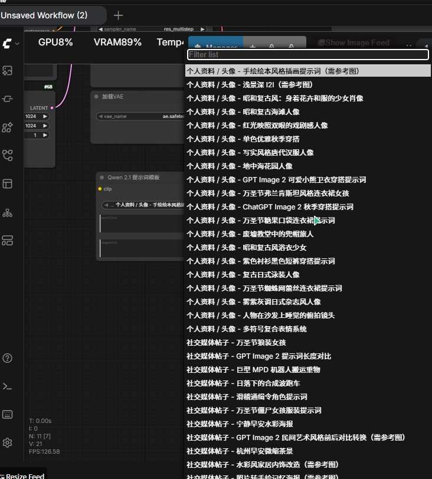

# ComfyUI_node_awesome_prompt

给 **Qwen-Image 2.1** 用的中英双语提示词模板节点：切换语种后下拉选模板，正向/负向提示词自动填充，之后可以继续手动修改。



## 功能

- 内置 **120 条模板，中英各一套且一一对应**：下拉框按「分类 - 标题」命名，支持前端搜索
- `语种` 下拉框在 `中文` / `English` 之间切换，模板列表随之切换，并自动定位到同一条模板的对应语言版本
- 选中模板后自动把正向、负向提示词写入两个文本框，可直接编辑
- 使用 Qwen-Image 2.1 专用文本编码模板（`clip.tokenize(..., keep_vision=True)`），输出 4096 维 conditioning
- 文本框留空时后端自动回退到模板内容，即使前端脚本未加载也能正常出图
- 模板数据放在 `prompts.json`，可自行增删

## 安装

```bash
cd ComfyUI/custom_nodes
git clone https://github.com/masterball-w/ComfyUI_node_awesome_prompt.git
```

重启 ComfyUI，在节点搜索里输入 `Qwen 2.1 提示词模板` 即可找到（分类：`conditioning/qwen image`）。

## 使用

节点输入输出：

| 名称 | 类型 | 说明 |
| --- | --- | --- |
| `clip` | CLIP | 必须接 Qwen-Image 2.1 的文本编码器 |
| `语种` | 下拉框 | `中文` / `English`，切换后模板列表与提示词语种同步切换 |
| `模板` | 下拉框 | 120 条模板（按语种显示对应语言），选中后自动填充下面两个文本框 |
| `正向提示词` | 多行文本 | 自动载入，可自由修改 |
| `负向提示词` | 多行文本 | 自动载入，可自由修改 |
| `positive` | CONDITIONING | 接 KSampler 的 positive |
| `negative` | CONDITIONING | 接 KSampler 的 negative |

推荐的完整链路：

```text
Unet Loader (GGUF)   qwen-image-2.1-*.gguf
CLIP Loader          qwen3vl_8b_*.safetensors, type = qwen_image
Qwen 2.1 提示词模板   ← 本节点
K Sampler            25 步 · CFG 1.0 · euler · simple · denoise 1.0
VAE Loader           qwen_image_2.1_vae_bf16.safetensors
```

注意事项：

- `CLIP Loader` 的 type 必须选 `qwen_image`，且编码器要用 8B 版本，否则 conditioning 维度是 2560，KSampler 会报维度错误
- 下拉列表中带「（需参考图）」后缀的模板是为图生图/参考图流程写的，纯文生图建议避开
- 已测试环境：ComfyUI 0.42.4 / 前端 1.55.18 / RTX 5060 Ti 16G，Q4_K_M 与 Q8_0 均可出图

## 模板数据

`prompts.json` 中的提示词来自开源项目 [YouMind-OpenLab/awesome-gpt-image-2](https://github.com/YouMind-OpenLab/awesome-gpt-image-2) 的 `README_zh.md` 与 `README.md`，中英各 120 条并按键值一一对应，按其 **CC BY 4.0** 许可使用，署名信息见 [NOTICE](NOTICE)。

原仓库只提供正向提示词，本节点的负向提示词按语种各提供一组通用质量词（中文/英文），可在节点内按需修改。

模板数据更新方式：重新解析上游 `README_zh.md` 与 `README.md`，覆盖 `prompts.json` 即可，节点代码无需改动。

## 目录结构

```text
ComfyUI_node_awesome_prompt/
├── __init__.py              # 节点实现与模板接口
├── prompts.json             # 120 条中文提示词模板
├── web/
│   └── qwen21_prompt_templates.js   # 下拉框联动填充
├── assets/
│   └── example.png          # 节点示例截图
├── NOTICE                   # 上游数据署名与许可
└── README.md
```

## License

- 代码：MIT，见 [LICENSE](LICENSE)
- 提示词模板数据：CC BY 4.0，归 [YouMind-OpenLab/awesome-gpt-image-2](https://github.com/YouMind-OpenLab/awesome-gpt-image-2) 所有
